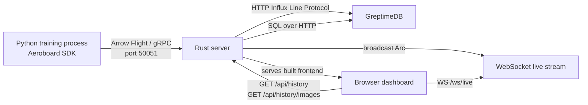
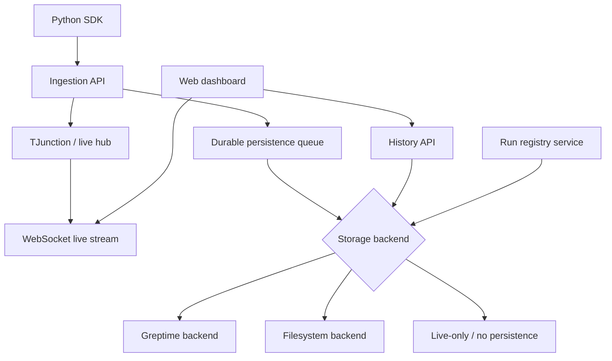

# Aeroboard Architecture

## Purpose

Aeroboard is a real-time experiment telemetry system for ML workflows. Its current design optimizes for low-copy movement of scalar metrics and media from Python training code into a Rust server and then into a browser UI.

The implementation is split across three main runtime components:

1. **Python SDK**: collects telemetry and sends Arrow `RecordBatch` payloads over Arrow Flight / gRPC.
2. **Rust server**: acts as the ingestion point, live-stream router, history API, and static file server.
3. **React dashboard**: loads persisted history on startup and consumes live Arrow IPC frames over WebSockets.

A fourth component is **optional at runtime today, but strongly coupled in code**:

4. **GreptimeDB**: receives persisted telemetry through an HTTP Influx Line Protocol endpoint and serves history through SQL-over-HTTP.

---

## Repository layout

- `src/aeroboard/`: installable Python package and CLI entrypoint.
- `aeroboard-client/src/aeroboard_client/`: second Python SDK package with largely duplicated client logic.
- `aeroboard-server/`: Rust ingestion, streaming, persistence, and history APIs.
- `aeroboard-web/`: React/Vite dashboard.
- `docker-compose.yml`: GreptimeDB local deployment.

---

## Current runtime topology



### Default ports

- `3000`: HTTP server, WebSocket endpoint, history APIs, static frontend.
- `50051`: Arrow Flight gRPC ingestion.
- `4000`: GreptimeDB HTTP API.

---

## End-to-end data flow

### 1. Python ingestion

The Python client buffers telemetry in memory and flushes Arrow batches when thresholds are reached.

Supported logical payloads today:

- **Scalars**: `timestamp`, `run_id`, `name`, `value`
- **Hyperparameters**: `timestamp`, `run_id`, `key`, `value`, `value_type`
- **Images**: `timestamp`, `run_id`, `name`, `image_data`, `format`
- **Distributions**: schema exists, but the full pipeline is not implemented end-to-end

The client currently resolves `run_id` versions by querying both:

- GreptimeDB directly
- the server's `/api/runs` live registry

This gives versioned names such as `experiment-v2`.

### 2. Rust ingestion service

The Arrow Flight `do_put` handler decodes incoming Flight frames into `RecordBatch` objects and publishes them into a central `TJunction` built on `tokio::sync::broadcast`.

`TJunction` responsibilities:

- fan out live batches to WebSocket subscribers
- keep an in-memory set of observed `run_id`s for `/api/runs`

### 3. T-junction split

After a batch is received, the server effectively splits it into two independent paths:

#### Path A: persistence

The persistence loop subscribes to the same broadcast channel and converts batches into GreptimeDB-compatible Influx Line Protocol.

Observed current behavior:

- scalars are persisted
- hyperparameters are persisted
- images are also persisted as hex-encoded strings
- distributions are not persisted

#### Path B: live streaming

WebSocket clients subscribe to the broadcast channel. Each batch is serialized into Arrow IPC stream bytes and pushed as a binary WebSocket frame.

### 4. Frontend consumption

On mount, the dashboard loads persisted history from:

- `GET /api/history`
- `GET /api/history/images`

Then it opens a WebSocket to `/ws/live` and merges incoming data into an in-memory store built from preallocated typed arrays.

Frontend rendering strategy:

- Arrow IPC decoded with `apache-arrow`
- scalar series stored in `Float64Array` buffers
- charts rendered with `uPlot`
- images stored in browser memory as base64 strings for timeline playback

---

## Component responsibilities

## Python SDK

### Responsibilities

- normalize and version `run_id`
- batch telemetry in memory
- coerce images to encoded bytes
- send Arrow `RecordBatch` payloads to the Flight server
- expose convenience callbacks for Lightning

### Strengths

- compact client API
- Arrow-native batch transport
- batching reduces per-event overhead

### Current limitations

- persistence concerns leak into the client through direct GreptimeDB lookups
- duplicated implementation exists in two Python package trees
- schema selection is implicit by batch shape rather than explicit message typing metadata
- distributions are not surfaced through the public client flush path in practice

---

## Rust server

### Responsibilities

- accept Flight uploads
- fan out live data
- persist historical data
- serve history APIs
- serve the web app bundle

### Strengths

- `Arc<RecordBatch>` keeps clone cost low
- `tokio` task split is simple and effective
- live streaming continues even if persistence fails

### Current limitations

- GreptimeDB endpoints are hard-coded
- persistence is not abstracted behind a storage interface
- history queries, deletion, and run versioning all assume GreptimeDB semantics
- only part of the Arrow schema surface is persisted/queryable
- no durable queue exists between ingestion and persistence
- the server both serves UI assets and acts as API/gRPC backend, which is simple but tightly coupled operationally

---

## Frontend

### Responsibilities

- load persisted history
- consume live telemetry
- keep an in-memory series store
- render metrics, comparison views, and image timelines

### Strengths

- avoids React state for hot-path timeseries updates
- typed-array storage is suitable for high-frequency metrics
- clear separation between historical bootstrap and live updates

### Current limitations

- fixed-size buffers can overflow on long sessions
- history is fetched with whole-table style endpoints instead of paged/windowed queries
- image payloads are materialized as base64 in browser memory, which is expensive
- no storage-awareness in the UI; it assumes historical APIs exist even when persistence is unavailable

---

## Persistence model today

The current persistence model is **GreptimeDB-centric**.

### What is coupled to GreptimeDB

1. **Write path**
   - server writes to `http://localhost:4000/v1/influxdb/write?db=public`
2. **Read path**
   - history endpoints query GreptimeDB with SQL-over-HTTP
3. **Delete path**
   - delete history sends SQL statements such as `DELETE FROM` and `TRUNCATE TABLE`
4. **Run versioning path**
   - Python client queries GreptimeDB to discover existing runs
5. **Operational flow**
   - CLI exposes `aeroboard db` specifically for GreptimeDB

### Practical consequence

GreptimeDB is nominally optional for live streaming, but the architecture does not yet treat persistence as a true plug-in. It is optional at runtime only because failures are swallowed in several places.

---

## Architectural risks and improvement areas

## 1. Introduce a storage abstraction

### Problem

Persistence logic is spread across the server and client, with GreptimeDB assumptions embedded in multiple layers.

### Recommendation

Create a storage boundary in the Rust server, for example:

- `StorageEngine`
- `HistoryStore`
- `RunRegistry`

Suggested capabilities:

- `append_batch(batch, kind)`
- `list_runs()`
- `query_scalars(filter)`
- `query_images(filter)`
- `query_hyperparameters(filter)`
- `delete_runs(filter)`

Backends can then be:

- `GreptimeStore`
- `FilesystemStore`
- `NoopStore` / `LiveOnlyStore`

This is the single highest-value architecture change.

## 2. Make filesystem persistence a first-class backend

### Why

A folder-backed mode would remove the database dependency for local workflows, demos, CI, and single-user usage.

### Recommended filesystem layout

```text
.aeroboard/
  metadata/
    runs.json
  runs/
    <run_id>/
      manifest.json
      hyperparameters.json
      scalars/
        date=2026-03-07/
          part-00001.arrow
          part-00002.arrow
      images/
        <metric_name>/
          1700000000000.png
          1700000000500.png
      events/
        part-00001.arrow
```

### Backend behavior

- write scalar and hyperparameter batches as Arrow IPC or Parquet files
- write images as raw files plus index metadata
- maintain a small manifest per run for fast listing
- expose the same history API shape regardless of backend

### Benefits

- no DB required
- easier debugging
- portable experiment artifacts
- simpler backup and sharing
- easier offline usage

### Trade-offs

- weaker ad hoc query power than a TSDB
- manual compaction and indexing may be needed for very large runs
- concurrency rules must be explicit if multiple writers are expected

## 3. Move run versioning entirely behind the server

### Problem

The client currently queries both GreptimeDB and the server to resolve versioned run IDs.

### Recommendation

Add a server endpoint such as:

- `POST /api/runs/resolve`

The server should consult the configured storage backend and return the authoritative resolved run ID. This removes database knowledge from the Python client.

## 4. Use explicit record type metadata

### Problem

The server infers payload type by inspecting column names and counts.

### Recommendation

Use Flight descriptor metadata, schema metadata, or an explicit enum field to identify batch type. This avoids fragile detection logic and simplifies backend evolution.

## 5. Separate ingestion, persistence, and query concerns

### Problem

One process currently handles:

- Flight ingestion
- WebSockets
- persistence
- query APIs
- static file hosting

### Recommendation

Keep the single-binary dev experience, but internally separate modules more clearly:

- `ingest`
- `stream`
- `storage`
- `query`
- `ui_host`

Later, these can remain in one binary or be split operationally if needed.

## 6. Add backpressure and spill strategy

### Problem

The broadcast channel is bounded, but there is no explicit ingestion durability or retry queue for persistence.

### Recommendation

Consider one of:

- bounded per-subscriber queues with drop metrics
- disk-backed write-ahead log before persistence
- a dedicated persistence worker channel separate from live fan-out

Live streaming and durable storage have different failure modes and should not fully share the same buffering path.

## 7. Finish or remove distribution support

### Problem

Distribution schema exists, but persistence and frontend history handling are incomplete.

### Recommendation

Choose one:

- complete end-to-end support with explicit UX and storage design
- or remove the unfinished surface until it is ready

## 8. Add paging and windowed history APIs

### Problem

History endpoints currently load large result sets with fixed SQL limits.

### Recommendation

Add filters such as:

- run IDs
- metric names
- time window
- page size
- cursor / continuation token
- optional downsampling level

This will matter regardless of whether the backend is GreptimeDB or filesystem.

## 9. Remove duplicated Python package code

### Problem

There are two similar client implementations:

- `src/aeroboard/`
- `aeroboard-client/src/aeroboard_client/`

### Recommendation

Keep one canonical implementation and have the other package import/re-export it, or move both to a shared core module.

## 10. Replace hard-coded configuration with a typed config layer

### Problem

Ports, URLs, and storage assumptions are embedded in source.

### Recommendation

Use environment variables and a config object for:

- server HTTP port
- Flight port
- storage backend type
- GreptimeDB URL
- filesystem data root
- retention settings
- batch and buffer limits

---

## Recommended target architecture



### Target principles

- keep the Arrow-native ingest and live path
- make persistence backend-pluggable
- make history API backend-agnostic
- move run resolution and storage knowledge into the server
- keep local development simple with filesystem default
- allow GreptimeDB for scalable querying and multi-run analytics

---

## Suggested migration plan

### Phase 1: abstraction

- define storage traits/interfaces in Rust
- wrap current GreptimeDB logic behind `GreptimeStore`
- route history and deletion through the abstraction

### Phase 2: filesystem backend

- implement `FilesystemStore`
- persist scalars/hyperparameters as Arrow or Parquet files
- persist images as files plus manifest/index
- add config switch: `AEROBOARD_STORAGE=filesystem|greptime|live`

### Phase 3: client simplification

- remove direct GreptimeDB queries from Python
- add server-backed run resolution endpoint
- keep client transport-only where possible

### Phase 4: history scalability

- add filtering, paging, and downsampling
- add run-scoped and metric-scoped queries

### Phase 5: cleanup

- merge duplicate Python implementations
- standardize Python environment creation, dependency sync, and command execution on `uv`
- finalize distribution support decision
- add metrics/observability around drops, persistence failures, and lag

---

## Summary

Aeroboard already has a strong core architecture for live telemetry:

- Arrow-native ingestion
- low-copy batch handling in Rust
- efficient browser-side typed-array rendering

The main architectural weakness is that persistence is conceptually optional but structurally coupled to GreptimeDB.

The most important next step is to make persistence a backend behind a stable server-side interface, with a **filesystem backend as the default local mode** and GreptimeDB as an optional scalable backend.

That change would make the system easier to run, easier to test, easier to debug, and much more flexible without giving up the current real-time data path.


# Implementation Plan

Plan: Filesystem-First Refresh
DRAFT

Aeroboard should move to a filesystem-first architecture with server-owned storage decisions, backend-agnostic history APIs, and optional GreptimeDB support only after the new file-backed path is stable. The main implementation sequence is: introduce config and storage abstractions in the Rust server, replace Greptime-specific history/delete logic with a StorageEngine, add a filesystem backend and new query model, simplify the Python SDK so it no longer talks to GreptimeDB, update the frontend to consume filtered/paged history plus live data, then clean up duplicated packages, tests, and docs. This plan assumes a breaking schema reset is acceptable and that delete must fail closed.

Steps

Define the target contracts and app state in the Rust server by introducing a central AppConfig and AppState in main.rs:25-52, replacing direct Arc<TJunction> state with a structure that carries t_junction, storage, and configuration for HTTP port, Flight port, storage mode, and filesystem root.

Create a storage boundary under the server for write, read, run registry, and delete responsibilities currently split across persistence.rs:8-44 and history.rs:130-315. The new interfaces should cover append_batch(), query_scalars(), query_images(), query_hyperparameters(), list_runs(), resolve_run_id(), and delete_runs().

Introduce explicit batch typing at ingestion so the server stops inferring record kind from column shape. The change should start in AeroboardFlightServer::do_put() in ingestion.rs:58-123 and flow through TJunction in t_junction.rs:10-67 as a typed envelope like TelemetryBatch { kind, batch } instead of raw RecordBatch.

Implement a FilesystemStore as the first production backend. Place scalar and hyperparameter history in Arrow IPC or Parquet partitions per run, persist images as files plus manifest/index data, and keep a small run manifest for fast list_runs() and summary lookup. This replaces the current Greptime-only write path in persistence.rs:49-170 and the current history queries in history.rs:130-315.

Redesign the history API around backend-agnostic filters and paging instead of whole-table fetches. Replace the current /api/history and /api/history/images assumptions in history.rs:74-125 with request parameters for run IDs, metric names, time range, page size, and cursor. Keep the response shape predictable for the frontend, but make it storage-neutral.

Add authoritative server-side run resolution and remove persistence knowledge from the Python SDK. Replace _fetch_existing_run_ids() and _resolve_run_id() in client.py:25-49 and client.py:131-141 with a server call such as POST /api/runs/resolve, backed by the configured StorageEngine. Mirror the same cleanup in client.py.

Consolidate the duplicated Python packages by choosing client.py as the canonical implementation and reducing client.py to a thin wrapper or shared import path. Do the same for schema.py and schema.py.

Standardize Python project management on uv. The root pyproject.toml should remain the source of truth, setup.sh should use `uv sync` instead of ad hoc install steps, tests and examples should run via `uv run`, and the documented workflow should avoid direct `pip` or manually activated `venv` commands.

Update the CLI and startup model so storage mode is explicit and the exposed --port behavior becomes real. Align main.py:48-88 with server config in main.rs:42-51, add options or environment variables for storage=filesystem|greptime|live, data_dir, and ports, and keep the GreptimeDB helper as optional operational tooling rather than part of the default happy path.

Refactor the frontend data hook in useAeroboard.ts:165-399 to use configurable API/WS bases, filtered history bootstrap, and paged loading. useAeroboard() should understand storage capabilities, tolerate live-only mode cleanly, and stop assuming that full history is always fetched in one call.

Improve client-side memory behavior in useAeroboard.ts:52-60 and rendering flow in App.tsx:153-385 by replacing fixed 200k buffers with growth or windowing strategy, avoiding base64-heavy image retention where possible, and aligning image history with filesystem-backed file references or efficient blob creation.

Harden server reliability by fixing task exit behavior and error handling in persistence.rs:11-44, streaming.rs:34-53, and ingestion.rs:90-117. broadcast::error::RecvError::Lagged should not kill persistence or WS tasks, and unwrap() paths should become structured errors with logs.

Decide the fate of distributions explicitly by reconciling schema.py:20-25, schema.rs:29-41, and the missing flush/persist/query path identified in persistence.rs:158-160. Either complete end-to-end support in the new storage model or remove the public schema surface until ready.

Rework delete semantics so deletion is confirmed by the active storage backend before the API reports success. Replace the current optimistic behavior in history.rs:427-500 and the immediate UI clearing in useAeroboard.ts:378-399 with fail-closed semantics and explicit user-visible errors.

Expand automated coverage across backend, SDK, and frontend. Build on tests.rs:12-100, test_logging_payloads.py, and test_run_versioning.py with new integration tests for ingestion→filesystem persistence→history replay, deletion, run resolution, and live-stream/history coherence. Add frontend tests around useAeroboard() bootstrap and paging behavior.

Update project documentation so the new architecture, storage modes, CLI flow, and schema reset are reflected consistently in ARCHITECTURE.md, README.md, and docker-compose.yml. GreptimeDB should be described as an optional backend, not a structural requirement.

Verification

Python: run `uv run pytest` from the repository root and ensure SDK tests pass after the package consolidation.
Rust: run cargo test in aeroboard-server with dedicated tests for FilesystemStore, typed ingestion, and history filters.
Web: run npm run lint and frontend tests in aeroboard-web once added.
End-to-end: start Aeroboard in filesystem mode, log scalars, hyperparameters, and images from the Python SDK, reload the UI, verify history replay, pagination, live updates, run resolution, and fail-closed deletion.
Optional backend validation: start Greptime mode separately and verify the same history contract without changing the frontend.
Decisions

Default backend: filesystem-first for local and single-machine use.
History API scope: add filters and paging now, not later.
Delete behavior: fail closed; no success response unless backend deletion succeeds.
Migration stance: prioritize the new filesystem schema and accept a clean break from current GreptimeDB schema/layout if needed.
Ownership: storage and run resolution become server responsibilities; the Python SDK becomes transport-first.