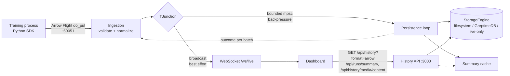

# Aeroboard Architecture

Aeroboard is a real-time experiment telemetry system for ML workflows: a Python SDK
sends scalar metrics, hyperparameters and media as Arrow batches to a Rust server,
which streams them live to a React dashboard and persists them for history.

More detail lives in the developer guide:
[architecture](docs/developer-guide/architecture.md) ·
[storage model](docs/developer-guide/storage-model.md) ·
[HTTP API](docs/reference/http-api.md) ·
[configuration](docs/reference/configuration.md).

## Repository layout

- `aeroboard-client/src/aeroboard_client/`: Python SDK and `aeroboard` CLI (packaged by the root `pyproject.toml`).
- `aeroboard-server/`: Rust ingestion, streaming, persistence and history API; also serves the dashboard.
- `aeroboard-web/`: React/Vite dashboard.
- `examples/`: runnable training scripts (plain PyTorch, Lightning, Ray Tune).
- `tests/`: Python SDK tests. Rust tests live in `aeroboard-server/src/tests.rs`, frontend tests in `aeroboard-web/tests/`.
- `docker-compose.yml`: optional local GreptimeDB.

## Runtime topology

Both servers listen on `127.0.0.1` by default (`AEROBOARD_HOST` to change). There is
no authentication, and no CORS headers are sent unless `AEROBOARD_CORS_ORIGINS` is set.

## End-to-end flow

1. **SDK.** `log()`/`log_metrics()` append rows to in-memory buffers. At `batch_size` the
   buffer becomes a `RecordBatch` and goes to a background sender thread, which uploads
   batches in order, retries transient failures with backoff, drops batches the server
   rejects, and caps unsent data at `max_queue_bytes` (oldest dropped first). Training
   code never waits on the network. `flush()` waits until the server confirms storage.
   Run IDs are resolved and reserved by the server (`POST /api/runs/resolve`).
2. **Ingestion.** `do_put` decodes the stream, determines the kind (descriptor path or
   column names), and validates and casts each batch to the canonical schema in
   `schema.rs`. Malformed batches fail the call with `INVALID_ARGUMENT`; they never reach
   storage code.
3. **T-junction.** Each batch goes to the live broadcast channel and to the bounded
   persistence queue. A full queue makes ingestion wait instead of dropping data.
4. **Persistence.** One loop appends each batch to the `StorageEngine`, updates the
   summary cache, and reports the outcome to the waiting upload. `do_put` acknowledges
   only after every batch of the upload is stored, so storage errors reach the client
   and are retried.
5. **Live stream.** Each batch is IPC-encoded once and pushed to every WebSocket client.
   Audio/video payloads are stripped when persisted (clients fetch them lazily). A lagging
   client gets a `{"type":"lagged"}` message and re-fetches history.
6. **Dashboard.** On selecting a run it loads history as one Arrow IPC response and merges
   it with live points already received (sorted by time and step, de-duplicated). It
   reconnects automatically and re-syncs after gaps. Media is displayed by URL.

## Data model

| Kind | Columns (canonical) |
| --- | --- |
| scalars | `timestamp` (ms), `run_id`, `name`, `value` (f64), `step` (f64, nullable) |
| hyperparameters | `timestamp`, `run_id`, `key`, `value`, `value_type` |
| images / audio / video | `timestamp`, `run_id`, `name`, `image_data`/`audio_data`/`video_data` (binary), `format` |
| distributions | schema reserved; not persisted or exposed by the SDK |

Older clients that send scalars without `step` are accepted; the column is filled with nulls.

## Storage backends

- **Filesystem** (default): per-run directories with append-only JSON Lines indexes and
  one file per media item. Appends cost O(batch) and all I/O runs on the blocking pool.
  Legacy `index.json` / `*.arrow` layouts are still read.
- **GreptimeDB**: line-protocol writes into pre-created append-mode tables keyed on
  `(run_id, metric)`, SQL reads. Tables from Aeroboard < 0.2 must be dropped (Delete All).
- **Live-only**: nothing is persisted; history endpoints return empty results.

## Design decisions

- **Separate persistence and live paths.** Durable storage needs backpressure and
  acknowledgement; live viewing needs low latency and may drop. They used to share one
  broadcast channel, which silently dropped persisted data whenever storage lagged.
- **Validate at the edge.** Storage codecs use positional typed downcasts. Normalizing
  every batch at ingestion keeps a single malformed upload from panicking the server.
- **Acknowledge after storage.** It makes `flush()` meaningful and gives at-least-once
  persistence when combined with client retries.
- **Arrow end to end.** Ingestion, live push and history all use Arrow. Dictionary-encoded
  history is several times smaller than the equivalent JSON.
